<!-- Save as README.md in the repository: Venc1el/Venc1el  (keep the assets/ folder next to it) -->

<p align="center">
  
</p>

<p align="center">
  <a href="https://sudarmoadi.netlify.app"></a>
  <a href="https://www.linkedin.com/in/sudarmo-adi-joyo-putro/"></a>
  <a href="https://github.com/Venc1el?tab=followers"></a>
</p>


### Hello, I'm Sudarmo

I'm a developer from Surabaya, Indonesia. I build **Flutter apps for public-service work**, the kind where the form has to work on the first try, and I do **full-stack web** on the side with React, TypeScript, Node, Express and Prisma.

I like clean architecture, tidy layers, and interfaces that feel right. I also like moving a button 2px and calling it a redesign.

```dart
void main() {
  final me = Developer('Sudarmo', alias: 'Venc1el');

  while (me.hasCoffee || me.hasDeadline) {
    me.build();
    me.overthink();
    me.refactor(scope: 'just a small one'); // it was not small
  }
}
```


### Spec sheet

| | |
|---|---|
| **Daily driver** | Flutter, Dart, clean architecture, Dio |
| **Also fluent in** | React, TypeScript, Node.js, Express, Prisma, .NET API contracts |
| **Superpower** | Spotting a 2px misalignment from across the room |
| **Weakness** | Fixing that 2px at 1 AM |
| **Known for** | "Just one more small change" |

### Toolbox

<p>
  
  
  
  
  
  
  
  
  
  
  
  
  
</p>


### The loud version

My portfolio is a paper collage with marker doodles and project cards that stack like papers on a desk. This README is its quiet cousin. Selected work (BangsaOnline, Apotek POS, Rental Checkout and more) lives over there:

**[sudarmoadi.netlify.app](https://sudarmoadi.netlify.app)**

### FAQ

**Does it work on your machine?**
Yes. Yours is a separate project.

**Are you open to work?**
Open to interesting projects, good coffee, and APIs that match their documentation.


<p align="center">
  <sub>Written in Dart, JavaScript, and an unreasonable number of browser tabs.</sub>
</p>
